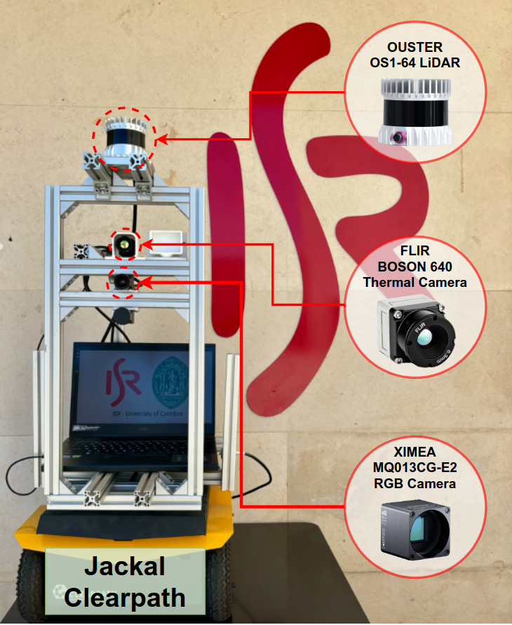
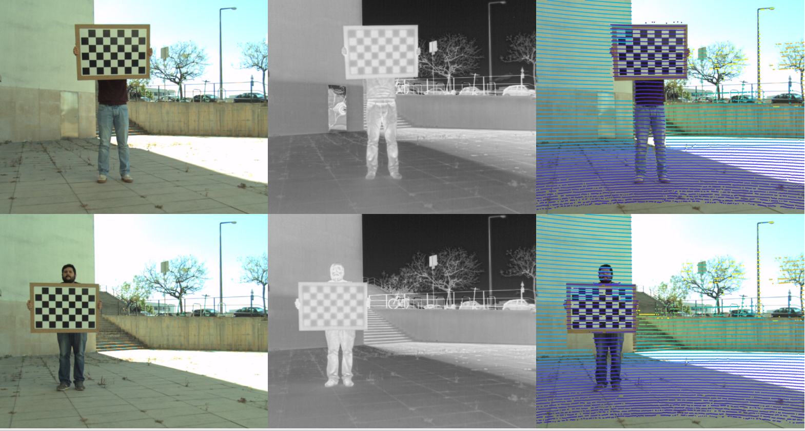
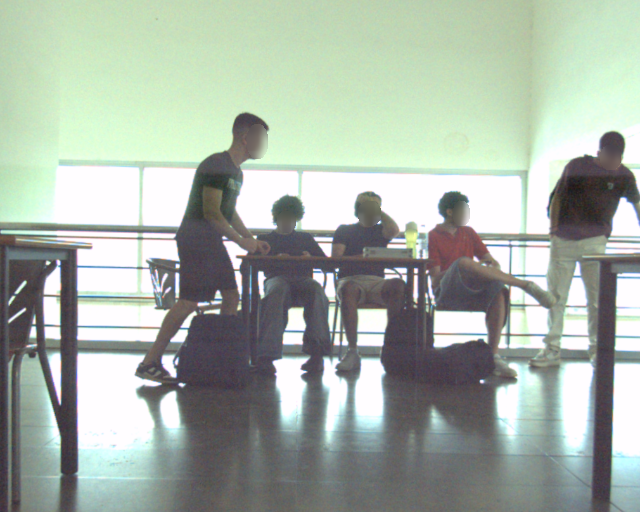
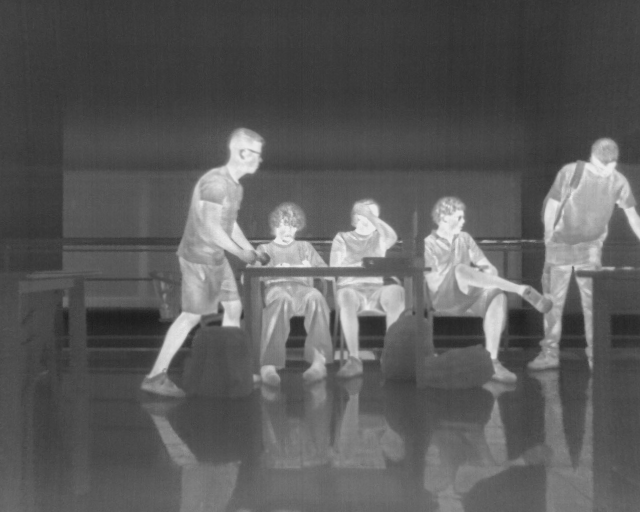

# MID-3K — Multimodal ISR Dataset

[Dataset website](https://kennedyk1.github.io/MID-3K/) · [Main repository](https://github.com/kennedyk1/MID-3K) · [Metadata CSV](metainfo.csv)

MID-3K is a calibrated and annotated multimodal dataset collected by the [Institute of Systems and Robotics (ISR)](https://www.isr.uc.pt/) at the University of Coimbra. A Clearpath Jackal robot recorded 3,083 scenes across three DEEC floors and two DEI floors. Each scene has RGB, thermal, depth, and intensity representations.

## Dataset access

The modality data and raw point clouds are maintained in dedicated repositories:

| Data | Repository | Contents |
| --- | --- | --- |
| RGB | [MID-3K-rgb](https://github.com/kennedyk1/MID-3K-rgb) | RGB images and labels |
| Thermal | [MID-3K-thermal](https://github.com/kennedyk1/MID-3K-thermal) | Thermal images and labels |
| Depth | [MID-3K-depth](https://github.com/kennedyk1/MID-3K-depth) | LiDAR-derived depth images and labels |
| Intensity | [MID-3K-intensity](https://github.com/kennedyk1/MID-3K-intensity) | LiDAR-derived intensity images and labels |
| Raw LiDAR point clouds | [MID-3K-pcd / `pcd/`](https://github.com/kennedyk1/MID-3K-pcd/tree/main/pcd) | Source point clouds for projection and derived modalities |

Clone the individual repositories you need:

```bash
git clone https://github.com/kennedyk1/MID-3K-rgb.git
git clone https://github.com/kennedyk1/MID-3K-thermal.git
git clone https://github.com/kennedyk1/MID-3K-depth.git
git clone https://github.com/kennedyk1/MID-3K-intensity.git
git clone https://github.com/kennedyk1/MID-3K-pcd.git
```

The first four repositories provide modality images and labels. `MID-3K-pcd` provides the raw LiDAR point clouds in `pcd/`.

`metainfo.csv` records the collection time, department, floor, and RGB/thermal annotation counts for every scene. Use it to make reproducible dataset splits and to associate modalities.

## Sensors and derived modalities

<p align="center">
  
</p>

| Modality | Sensor | Representation | Resolution | Labels |
| --- | --- | --- | --- | --- |
| RGB | Ximea MQ013CG-E2 | Colour image | 640 × 512 | YOLO `xywhn` |
| Thermal | FLIR Boson 640 LWIR | Thermal image | 640 × 512 | YOLO `xywhn` |
| Depth | Ouster OS1-64-U | LiDAR-derived depth image | 640 × 512 | YOLO `xywhn` |
| Intensity | Ouster OS1-64-U | LiDAR-derived intensity image | 640 × 512 | YOLO `xywhn` |

The depth and intensity images are generated by projecting LiDAR points onto the RGB image plane using the COLOR–LiDAR calibration, then producing dense representations from the projected clouds. The RGB labels are used for the LiDAR-derived modalities because the LiDAR is calibrated to the RGB camera. A small temporal misalignment between sensors may be present because of hardware limitations.

## Calibration

The canonical calibration files are versioned in [`calibration/`](calibration/). They contain only the matrices required for use: camera intrinsics `K`, OpenCV radial-tangential distortion coefficients `D`, and homogeneous extrinsics `T`.

For every transform below, points are column homogeneous vectors and the stated equation gives the exact direction. Do not invert a matrix unless the destination frame changes.

### COLOR camera from LiDAR

File: [`calibration/color_lidar/calibration.yaml`](calibration/color_lidar/calibration.yaml)<br>
Convention: `p_color = T_color_from_lidar × p_lidar_h`<br>
Translation unit: metres

```text
K_color =
[[681.1537743213527,   0.0,               304.2411111909714],
 [  0.0,             699.3400141294942, 283.30909783571593],
 [  0.0,               0.0,               1.0]]

D_color = [-0.019676053622695044, 0.007583580084736622,
           -0.0006813210784568897, -0.0014894295933110943,
           -0.028837736877494857]

T_color_from_lidar =
[[-0.020711213611204426, -0.9997756359099763,  0.004441111522331731, -0.026308843328480876],
 [-0.028370516356301556, -0.0038525674496390216, -0.999590051734071,  -0.24229990018544303],
 [ 0.999382889303408,    -0.02082871971218364,  -0.028284359683814708, -0.12754424641116704],
 [ 0.0,                   0.0,                   0.0,                  1.0]]
```

### THERMAL camera from LiDAR

File: [`calibration/thermal_lidar/calibration.yaml`](calibration/thermal_lidar/calibration.yaml)<br>
Convention: `p_thermal = T_thermal_from_lidar × p_lidar_h`<br>
Translation unit: metres

```text
K_thermal =
[[707.2820029925454,   0.0,               354.45491526689966],
 [  0.0,             703.7786568007459, 227.1052281742882],
 [  0.0,               0.0,               1.0]]

D_thermal = [-0.12429506535239071, 0.7476399506397287,
             -0.00795472864117167, 0.02219946671789782,
             -1.1615169504885268]

T_thermal_from_lidar =
[[-0.07141160958328907, -0.9974028109990063, -0.009381611162468106, -0.08459234939344676],
 [ 0.020450563863161964, 0.007939566254821173, -0.9997593399040408,   -0.1531295681987805],
 [ 0.9972372618662031,  -0.07158628289669194,   0.01983047267798277,  -0.08319853666931896],
 [ 0.0,                  0.0,                    0.0,                   1.0]]
```

### THERMAL camera from COLOR camera

File: [`calibration/color_thermal/calibration.yaml`](calibration/color_thermal/calibration.yaml)<br>
Convention: `p_thermal = T_thermal_from_color × p_color_h`<br>
Translation unit: millimetres

```text
K_color =
[[694.5767783863788,   0.0,              306.0005310511457],
 [  0.0,             713.418983871438, 286.06474899454673],
 [  0.0,               0.0,               1.0]]

D_color = [-0.009937498982803262, -0.004021254951108735,
            0.000006275579508020951, -0.000992441470247646,
           -0.04372114079253327]

K_thermal =
[[707.2820015296844,   0.0,               354.4549139181772],
 [  0.0,             703.7786553036885, 227.10522697281073],
 [  0.0,               0.0,               1.0]]

D_thermal = [-0.12429506339571258, 0.7476399197335876,
             -0.007954728400070676, 0.022199465982827807,
             -1.1615168961926972]

T_thermal_from_color =
[[ 0.9983917175807383,  0.011889988456163505, -0.055431096333156286, -13.602106271762803],
 [-0.009109137461417548, 0.9986999976148243,   0.05015314924168618,   31.499143889039583],
 [ 0.05595535614123418, -0.049567559337354364, 0.9972021135058056,     0.16229630951639198],
 [ 0.0,                  0.0,                  0.0,                    1.0]]
```

`D` follows OpenCV's `[k1, k2, p1, p2, k3]` coefficient order. The COLOR and THERMAL intrinsics in the stereo result are the intrinsics estimated for that stereo calibration; use each `K`, `D`, and `T` from the same calibration block.

<p align="center">
  
</p>

## Dataset summary

| Metric | RGB | Thermal | Depth | Intensity | LiDAR point clouds |
| --- | ---: | ---: | ---: | ---: | ---: |
| Images / point clouds | 3,083 | 3,083 | 3,083 | 3,083 | 3,083 |
| Annotation files | 3,083 | 3,083 | 3,083 | 3,083 | — |
| Person annotations | 10,824 | 10,881 | 10,824¹ | 10,824¹ | — |
| Approx. repository size | 1.3 GB | 1.3 GB | 977 MB | 1.7 GB | 6.5 GB |
| Annotation format | YOLO `xywhn` | YOLO `xywhn` | YOLO `xywhn` | YOLO `xywhn` | — |

¹ The LiDAR-derived modality labels use the RGB labels. The raw LiDAR repository contains point clouds; 2D annotation files and a YOLO annotation format do not apply to it.

<p align="center">
  
  
  
  
</p>

## Collection distribution

| Day | Date | Images | Thermal annotations | RGB annotations | Split |
| --- | --- | ---: | ---: | ---: | --- |
| 1 | 29-Apr | 368 | 1,368 | 1,404 | Test |
| 2 | 07-May | 332 | 1,075 | 1,072 | Train |
| 3 | 08-May | 337 | 1,658 | 1,651 | Test |
| 4 | 09-May | 1,333 | 4,199 | 4,125 | Train |
| 5 | 16-May | 713 | 2,581 | 2,572 | Train |
| **Total** | — | **3,083** | **10,881** | **10,824** | — |

## Related datasets

- [MID-1K — Multimodal ISR Dataset with 1100 images](https://kennedyk1.github.io/MID-1K/)
- [MID-3K dataset website](https://kennedyk1.github.io/MID-3K/)

## References

- Sousa, E., Mota, K. O., Gomes, I. P., Garrote, L., Wolf, D. F., & Premebida, C. (2023). **Late-Fusion Multimodal Human Detection Based on RGB and Thermal Images for Robotic Perception**. *2023 European Conference on Mobile Robots (ECMR)*, 1–6.
- Kennedy O. S. Mota, Luís Garrote, Cristiano Premebida. **Multimodal Human Detection using RGB, Thermal and LiDAR modalities for Robotic Perception**. *2024 IEEE 20th International Conference on Automation Science and Engineering (CASE)*, Bari, Italy.
- Kennedy O. S. Mota, Diogo S. de Oliveira, Luís Garrote, Cristiano Premebida. **Multimodal Human Detection Using YOLO and Representation Learning for Robot Perception**. *Seventh Iberian Robotics Conference (ROBOT 2024)*. [Preview document](https://github.com/kennedyk1/MID-3K/blob/main/Multimodal%20Human%20Detection%20Using%20YOLO%20and%20Representation%20Learning%20for%20Robot%20Perception.pdf)
